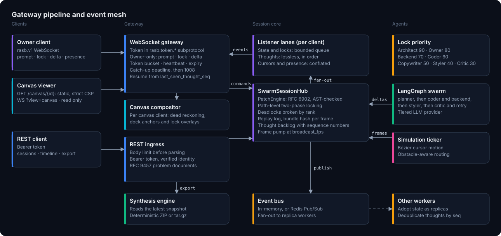
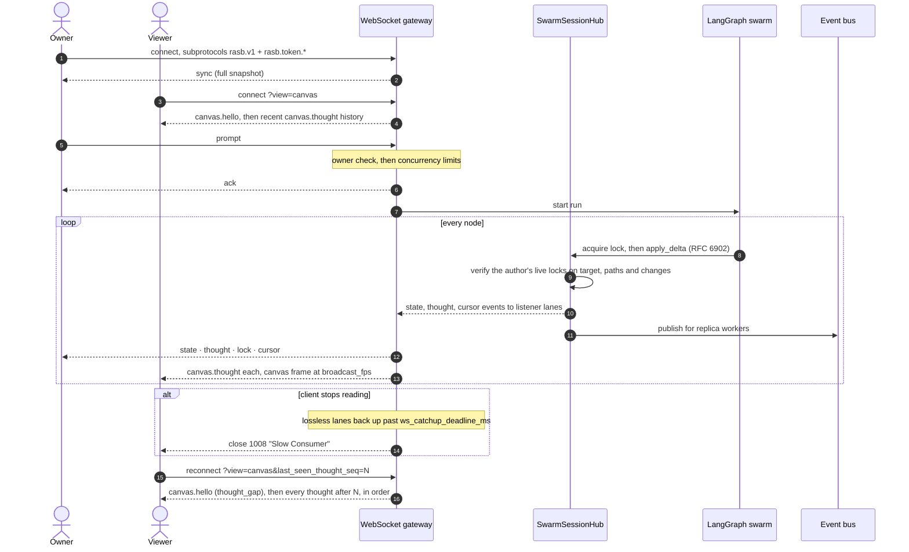
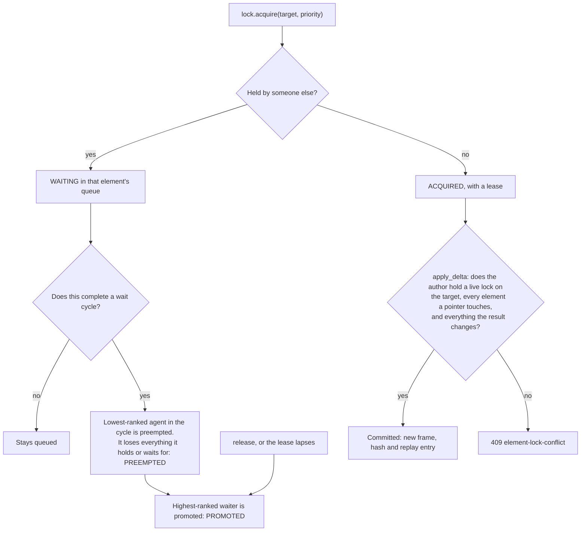
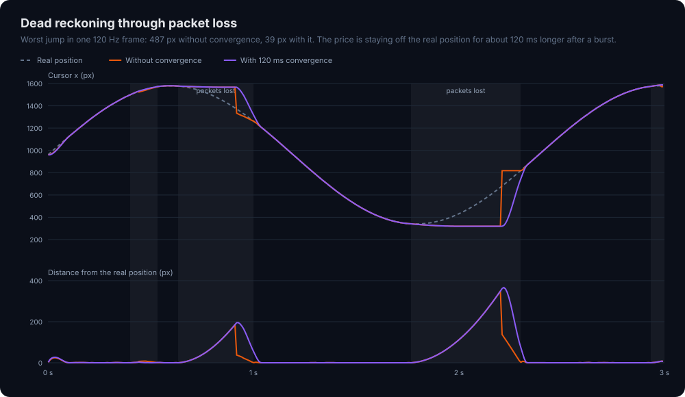
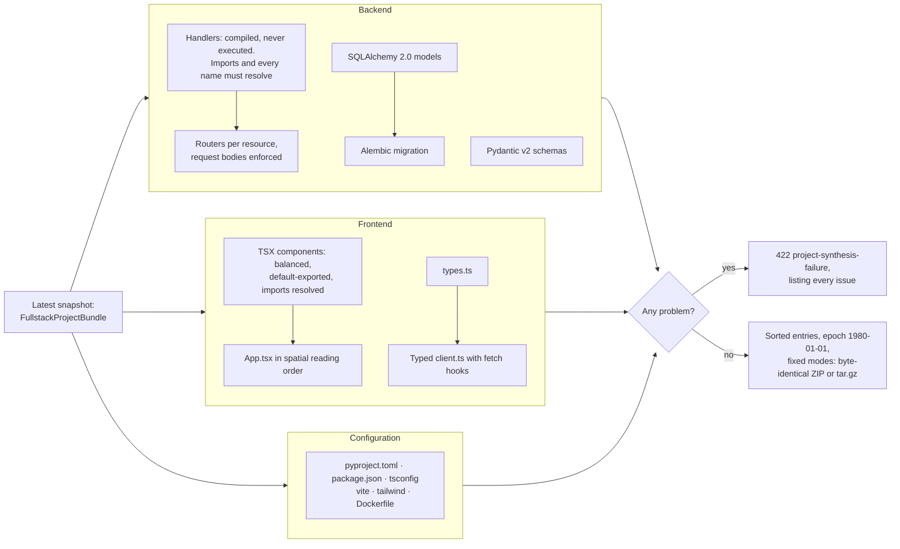

# realtime-agentic-site-builder

**A swarm of AI agents builds a full-stack website together, live, while people watch and steer.**
Six agent roles plan, code, style and review a FastAPI + React project concurrently. Every change
is a lock-checked RFC 6902 patch, every thought streams to every viewer in order, and the result
compiles into a runnable, byte-reproducible repository.


<sub>The GIF is rendered from the platform's own cursor simulator, lock manager, patch engine and
canvas compositor running a scripted session, by
[`scripts/generate-demo-assets.py`](scripts/generate-demo-assets.py). It is not a screen
recording or a hand-made animation. The mirrored sections are rebuilt from exactly the patches
and corrections a viewer is sent, and the generator stops if they ever differ from what the
engine committed. Its HUD shows only what a simulation can derive; the live page adds token
spend and measured latency.</sub>

---

## Contents

- [What it does](#what-it-does)
- [Proof of engineering](#proof-of-engineering)
- [Architecture](#architecture)
- [The live canvas: mirror, HUD, time travel](#the-live-canvas-mirror-hud-time-travel)
- [Protocol: `rasb.v1`](#protocol-rasbv1)
- [REST API and errors](#rest-api-and-errors)
- [Quickstart](#quickstart)
- [Configuration](#configuration)
- [Development](#development)
- [Known limits](#known-limits)

## What it does

| Capability | How |
|---|---|
| **Collaborative agent swarm** | A LangGraph state machine runs planner → coder ‖ backend → styler → critic, looping back on rejected work. Each role can use a different model (tiered routing across Anthropic and OpenRouter). |
| **Safe concurrent editing** | Every change is an RFC 6902 patch. The hub commits it only if its author holds a live lock on the target, on every element each pointer resolves to, and on everything the result changes. Deadlocks are broken by rank. |
| **Live multiplayer** | One WebSocket carries state, lock changes, presence and a lossless, sequenced thought stream. Reconnecting clients resume from the last thought they saw. |
| **Read-only viewers** | Anyone in the tenant can watch and show presence. Only a session's owner can prompt, lock, edit or delete. |
| **Visual canvas** | `GET /canvas/{id}` serves one self-contained page: a live DOM mirror of the site, kept current by RFC 6902 patches, under a telemetry layer of Bézier trails, Hermite dead reckoning, lock outlines and docked thought badges. Under 64 KB, no external requests, hash-based CSP. |
| **Time travel and forking** | Scrub a session's retained history in the browser, and fork any frame into a new session of your own with `POST /api/v1/sessions/{id}/fork?from_seq=N`. A fork shares its past with its source rather than copying it. |
| **Human override** | The owner can take any element from an agent at once (`lock.override`, priority 95, above the Architect's 90). The agent is told why, and every viewer sees it happen. |
| **Runtime verification** | `GET /api/v1/sessions/{id}/verify` checks seven safety invariants against the session's recorded history, and names where any of them broke. |
| **Operable** | Every request and socket gets an `X-Request-ID` that appears in problem documents and log records. `/healthz` for orchestrators, and `/metrics` in the Prometheus format. |
| **Runnable export** | `GET /api/v1/sessions/{id}/export` compiles the session into a FastAPI + SQLAlchemy + Alembic backend and a Vite + React 19 + Tailwind frontend with a typed API client, as a deterministic ZIP or tar.gz. |

## Proof of engineering

Every row is either enforced by the test suite on every run or was measured during development,
as marked.

| Property | Result | Source |
|---|---|---|
| Line and branch coverage | **100.00%** across 1,525 tests | Enforced: [`scripts/coverage-gate.sh`](scripts/coverage-gate.sh) fails on any regression |
| Lock protocol, exhaustively | **Every** reachable state of the real lock manager, for two agents, a person and two elements: **41,211** states and **576,954** transitions, each checked for mutual exclusion, no orphaned queue, no surviving wait cycle, no unannounced loss of a live hold and best-ranked promotion. It catches each of 5 deliberately planted protocol bugs | Enforced: [`tests/unit/test_model_checking.py`](tests/unit/test_model_checking.py). The planted bugs were measured once |
| Exact DOM mirror | Patches, then the server's corrections, reproduce **every** committed layout of a 400-step random workload, value for value | Enforced: [`tests/unit/test_mirror.py`](tests/unit/test_mirror.py) |
| Page ↔ engine patch parity | The viewer's own RFC 6902 code agrees with the patch engine on **4,000** random operations, success and failure alike, and rebuilds **every** commit of a 300-step workload | Enforced by the suite when Node is installed, skipped otherwise |
| Zero-copy forks | Forking a 20-commit session at frame 11 shares **12 frames** (**29,149 bytes** of state) by reference and copies none; the source is unchanged | Enforced: frame identity in [`tests/unit/test_breakthrough.py`](tests/unit/test_breakthrough.py). Sizes measured by the asset generator |
| Mutation testing | **604 of 620** mutants killed (97.42%) across the locking, patching, hub, invariant monitor, auth, motion, compositing, mirror and export modules. **All 604** that a test could tell apart are killed; the other 16 are equivalent, each with its reason | Measured: [`scripts/mutation-test.py`](scripts/mutation-test.py), run on demand, about 5 minutes |
| Canvas frame pacing | **60.0 FPS** on a fixed schedule, p95 interval **18.3 ms**, under a flood of ~600 thoughts/s | Measured. The chaos suite enforces > 54 FPS and p95 < 41.7 ms while a stalled client is evicted |
| Motion under 50% packet loss | Median error **≈ 1 px**. After a burst, the visible jump stays **under 1/8** of the error the coast accumulated | Enforced: [`tests/unit/test_canvas.py`](tests/unit/test_canvas.py), 5 seeded loss patterns |
| Python ↔ JavaScript motion parity | **0.000000 px** divergence over 2,400 frames at 50% loss | Measured with an out-of-tree Node harness. Not part of CI, which runs no JavaScript |
| Deterministic synthesis | **Byte-identical** ZIP (equal SHA-256) from two independent runs of the same prompt | Enforced: [`tests/integration/test_e2e_lifecycle.py`](tests/integration/test_e2e_lifecycle.py) |
| Lock arbitration | Same winner order for **all 6** arrival orders of three contenders | Enforced: [`tests/integration/test_e2e_chaos.py`](tests/integration/test_e2e_chaos.py) |
| Zero-loss catch-up | A client dropped mid-burst resumes with **every** missed thought, none repeated | Enforced: chaos suite |
| Teardown | **No leaked tasks** in `asyncio.all_tasks()` after deleting a session mid-run | Enforced: chaos suite |
| Bounded memory | 200 edits on a 1 MB bundle once retained 199 MB. Replay history is now held within a per-session byte budget | Enforced: [`tests/unit/test_hardening.py`](tests/unit/test_hardening.py) |
| Tenant isolation | Per-person limits on sessions, sockets, locks, edits per second and concurrent exports, so no one person can starve the rest | Enforced: hardening suite |
| Replay integrity | Re-applying the patch log reproduces **every** recorded state hash | Enforced: lifecycle suite |

The test suite opens no network sockets (`pytest-socket` blocks them), makes no model calls, and
runs in about 75 seconds with coverage, a fifth of it the exhaustive model check.

## Architecture



### Event mesh and gateway lifecycle



Each client gets its own listener with three lanes. **State and lock events** wait in a bounded
queue, which may drop the oldest, because every state event carries the full bundle. **Thoughts**
have no substitute, so their lane is lossless and ordered. **Cursors and presence** keep only the
latest value per participant. A client that cannot drain its lossless lanes within
`ws_catchup_deadline_ms` is evicted, so it can never slow anyone else down. Canvas connections
fold everything into a compositor and send one frame per tick, so motion is never queued at all.

### Two-phase locking and conflict arbitration




<sub>Every cell is the real lock table after each step, produced by running the scenario through
`AsyncLockManager`.</sub>

Priority never preempts a live holder. It only decides who is promoted next, and who gives way
when a deadlock forms. The ranking is total, so every replica picks the same winner: priority,
then the older Lamport timestamp, then the agent id.

| Rank | Participant | Priority |
|---:|---|---:|
| 1 | Architect | 90 |
| 2 | **Human owner** | 80 |
| 3 | Backend Engineer | 70 |
| 4 | Frontend Coder | 60 |
| 5 | Copywriter | 50 |
| 6 | Styler | 40 |
| 7 | Critic | 30 |

The one exception is the **human override**. The session's owner can send `lock.override`, which
takes an element at priority 95, above every agent, from a live holder of lower priority. The
holder loses only that element and gets a `PREEMPTED` event with the reason, and everyone else
gets an `OVERRIDDEN` one, which the canvas shows as an alert in the person's color. Against a
holder of equal or higher priority, or no holder at all, it is an ordinary `lock.acquire`.

Locks are path-level. A lock on component `hero` does not cover the site title, which belongs
to `frontend:document`, or any other component.

Leases last `RASB_LOCK_LEASE_MS` (5 s by default). Agents renew theirs in the background while
they work. A person's client renews by sending `lock.acquire` again for a target it already
holds, which costs nothing against its quota. A lease left to lapse is reported as `TIMED_OUT`.

### Motion under packet loss



Telemetry arrives at 30 Hz at best, and the viewer renders at the display's rate. Positions are a
cubic Hermite spline through the samples that arrived, using their real timestamps, so a dropped
frame only widens a segment. A burst of losses outlasts any render buffer, so the track coasts,
decelerating, and the next sample shows how wrong the guess was. Snapping to it is the jump on the
left. Convergence eases the error out over 120 ms instead. That costs accuracy for a moment, as
the lower panel shows, and buys a cursor that never teleports. The server and the viewer run the
same arithmetic, with the constants compiled into the page.

### Deterministic project synthesis



Generated code was written by language models, so synthesis never runs it. It refuses anything
that would keep the exported service from starting or building: an unresolvable import, an
undefined name, a reserved field name, a component importing a package that isn't declared.
Package names are never added automatically, because models invent convincing ones.

## The live canvas: mirror, HUD, time travel

### A live mirror of the site, not a preview

Behind the telemetry layer, the canvas page draws the site the agents are building, at each
section's real coordinates and in the site's theme. Each section is a skeleton for its kind of
component with its real title. The generated code is never run: language models wrote it, so the
page holds it as data, builds every element with `createElement`, and writes text only through
`textContent`. Its policy allows no other script anyway.

It stays current without reloading anything. `canvas.hello` carries the layout at a frame, and
every later commit arrives as a `canvas.delta` holding its RFC 6902 patches. The page applies them
to its own copy, all or nothing, then changes only the DOM nodes whose title, kind or box differs.
Patches alone are not quite enough: after applying them the engine stamps each component's
version and checksum, and validation normalizes text (NFKC, entity decoding, injection
stripping), none of which a browser can reproduce exactly. So the server works out what is left
and sends it as more patches, `corrections`. With them the copy equals the committed layout,
value for value, as the suite checks against the real engine. A missed frame shows up as a gap
in `frame_seq`, and the page rebuilds from `GET …/history` before applying what it had queued.

A section that is committed to, or taken by a new holder, gets a kick: a spring impulse that
grows with the speed of the cursor that delivered it and pushes along its path, and a halo in
the author's color. The spring is underdamped (stiffness 260/s², damping 16/s, damping ratio 0.5)
and rings down within 490 ms. Locked sections keep a soft halo in their holder's color.
With `prefers-reduced-motion` set nothing moves: sections only glow, and the radar's rings fade
in place.

### Heads-up display

Press **H**, or use the toolbar.

| Readout | What it shows, and how it is measured |
|---|---|
| Graph state | A radar with one axis per LangGraph node, scaled by how often each has run. Running nodes pulse. A critic's rejection sends a red ring out from the center, an approval a green one |
| Burn | Tokens reported by the thoughts this view has received, and their cost in USD to $0.0001. Cost appears only for calls whose model has a price in `RASB_MODEL_PRICES`, with the share of tokens priced when that is not all of them. Nothing is priced by default |
| Latency | Socket round trip p95 and p99, from a ping a second while the HUD is open, and frame arrival to paint p95 and p99. Not commit-to-screen latency: the server's and browser's clocks are not synchronized |
| Timeline | The frame the mirror holds, and the commits it has applied |
| Verify invariants | Runs `GET …/verify` and lists every invariant with what it checked |
| Human override | Owner only. Select an element on the canvas, then **O** to take it or **R** to release it |

### Time travel and forking


<sub>Measured by the asset generator on the real hub. The diagram stops if the fork shares
fewer frames than documented, or if the source changes.</sub>

Press **T** for the timeline. `GET …/history` returns the retained window compactly: one base
layout, then each delta with its corrections and the lock table after it. The page rebuilds any
frame by patching forward from the nearest checkpoint, one every 16 frames, so a scrub never
replays more than 15 deltas, and outlines the locks held at that frame. **Esc** returns to live.

**Fork from here** branches the frame on screen into a new session with
`POST …/fork?from_seq=N`, and opens it with the same token. Frames and the bundles in them are
immutable, so the fork shares its past with its source instead of copying it: the cost is a
reference per frame, whatever the bundle's size. The fork starts with no locks, thoughts, run or
clients, belongs to whoever made it, and counts toward their session limit. Forking leaves its
source untouched, so any viewer may fork a session they can watch.

### Runtime invariant monitor

`GET …/verify` checks the session's recorded history, not what the code meant to do, so a defect
anywhere upstream shows up as a named violation at a frame:

| Invariant | Holds when |
|---|---|
| `log-complete` | Every frame after the first has exactly one delta that produced it |
| `frames-contiguous` | Frame numbers rise by exactly one |
| `deltas-ordered` | Delta sequence numbers strictly increase |
| `mutual-exclusion` | No frame records two holders of one element |
| `commits-locked` | Every delta's author held its target when it committed |
| `leases-live` | And that hold had not lapsed |
| `replay-exact` | Replaying the log from its first frame reproduces every recorded hash |

It runs in time linear in the log, plus one patch application per delta, off the event loop and
within the same concurrency limit as exports.

## Protocol: `rasb.v1`

Connect to `/ws/sessions/{session_id}` offering two subprotocols: `rasb.v1`, and
`rasb.token.<token>`. A browser cannot set headers on a WebSocket, and a query string ends up in
access logs, so the token travels as a subprotocol. The server echoes only `rasb.v1`.
Non-browser clients may send `Authorization: Bearer <token>` instead.

| Query parameter | Effect |
|---|---|
| `last_seen_thought_seq=N` | Replay every retained thought after `N` before the live stream. |
| `view=canvas` | Receive composited canvas frames instead of raw events. |

Every client message may carry a `request_id` of up to 64 characters, which its `ack`, `pong` or
`error` repeats. A message that claims an identity, such as `agent_id` or `user_id`, is rejected
outright. Identity comes only from the verified token.

### Client → server

| `type` | Fields | Who |
|---|---|---|
| `ping` | | anyone. Doubles as the heartbeat |
| `cursor` | `x`, `y` | anyone |
| `select` | `target_id` or `null` | anyone |
| `lock.acquire` | `target_id` | owner |
| `lock.release` | `target_id` | owner |
| `lock.override` | `target_id` | owner. Takes the element at priority 95 from a live holder of lower priority. Against anyone else, the same as `lock.acquire` |
| `delta` | `target_domain` (`frontend` or `backend`), `target_id`, `patches` (RFC 6902) | owner |
| `prompt` | `text` (1 to 4,096 characters) | owner |

A viewer sending an owner-only message gets an `error` frame with a 403 `permission-denied`
problem, and nothing changes. Each person may hold or wait for at most `RASB_WS_MAX_LOCKS_PER_USER`
locks, and commit at most `RASB_WS_MAX_DELTAS_PER_SECOND` deltas across all of their connections.
Beyond either, the reply is a 429 `capacity-exceeded` problem.

### Server → client

| `kind` | Stream | Carries |
|---|---|---|
| `sync` | default | First frame: `session_id`, verified `user_id` and `agent_id`, full `snapshot`, `latest_thought_seq`, `replayed_thoughts`, `thought_gap` |
| `thought` | default | `seq` (contiguous per session) and `thought`: agent, role, text, tool name, tool arguments, tokens, latency, and `cost_usd` when the model is priced |
| `state` | default | The committed `delta` and the resulting `snapshot`, with its `bundle_hash` |
| `lock` | default | `event.kind` is `PROMOTED`, `PREEMPTED`, `TIMED_OUT` or `OVERRIDDEN`, with the `lock` and an RFC 9457 `problem` for the loser |
| `cursor` | default | One agent's `frame`: position, action, current thought, active lock |
| `presence` | default | A person's `user_id`, `x`, `y`, `selected_id`, `active` |
| `canvas.hello` | canvas | `session_id`, `user_id`, `agent_id`, `is_owner`, `latest_thought_seq`, `replayed_thoughts`, `thought_gap`, and the `frontend` layout as of `frame_seq` |
| `canvas.thought` | canvas | `seq`, `agent_id`, `label`, `color`, `text` (at most 200 characters), `tool_name`, the graph `node` it entered or left, a critic's `approved`, `tokens`, `cost_usd`. Each one sent once, in order |
| `canvas.delta` | canvas | A commit: `frame_seq`, `delta_seq`, `agent_id`, `target_id`, the author's `color`, `target_domain`, and for the frontend its `patches` and `corrections`. Each one sent once, in order |
| `canvas.override` | canvas | `target_id`, and `by`: the person who took it, with their `label` and `color` |
| `canvas` | canvas | `t_ms`, `agents` (position, velocity in px/s, action, dock), `humans`, `badges` (phase, opacity), and `scene` (viewport, lock overlays) only when it changed |
| `ack` | both | `request_id`, `type`, and `lock` or `frame_seq` where relevant |
| `pong` | both | `request_id`, `server_time_ms` |
| `error` | both | `request_id` and an RFC 9457 `problem` |

`thought_gap: true` means some thoughts after your `last_seen_thought_seq` are gone for good,
because the backlog holds only the newest `thought_backlog_size`.

### Close codes

| Code | Reason |
|---|---|
| 1000 | Session closed |
| 1001 | Server shutting down, after delivering what was buffered |
| 1008 | Authentication required · Too many connections · Token expired · Heartbeat timeout · Rate limit exceeded · Slow Consumer · Invalid connection parameters |
| 1009 | Message too big |
| 1011 | Internal error |
| 4404 | Session not found |

## REST API and errors

Every route needs `Authorization: Bearer <token>`. The interactive schema is at `/docs`.

| Method and path | Purpose | Success |
|---|---|---|
| `POST /api/v1/sessions` | Create a session. Optional body: `prompt` starts a run, `bundle` sets the starting state | `201` with `session_id`, `snapshot`, `run_started`, and a `Location` header |
| `GET /api/v1/sessions/{id}` | Latest snapshot | `200` |
| `GET /api/v1/sessions/{id}/timeline` | Every delta and frame, plus the thought backlog | `200` |
| `GET /api/v1/sessions/{id}/history` | The retained window, compactly: the base frame's layout and locks, then each delta with its `corrections` and the lock table after it | `200` |
| `GET /api/v1/sessions/{id}/verify` | Check seven safety invariants against the recorded history. Runs in the thread pool, within `RASB_GATEWAY_MAX_CONCURRENT_EXPORTS` | `200` with each invariant, what it checked, and up to 5 violations |
| `POST /api/v1/sessions/{id}/fork?from_seq=N` | Branch frame `N` into a new session owned by the caller. Any tenant user may fork, within their session limit | `201` with `session_id`, `snapshot`, `run_started`, and a `Location` header |
| `GET /api/v1/sessions/{id}/export?format=zip` | Compile and download the project. `format` is `zip` or `tar.gz` | `200`, streamed `application/zip` or `application/gzip` |
| `DELETE /api/v1/sessions/{id}` | End the session, its run, ticker and connections. Owner only | `204` |
| `GET /canvas/{id}` | The canvas viewer page. No token: it is static, and the socket authenticates | `200` `text/html` |
| `GET /healthz` | Liveness, for orchestrators. No token, and it reveals nothing | `200` |
| `GET /metrics` | Gauges and counters in the Prometheus text format | `200` `text/plain` |

Every failure is an [RFC 9457](https://www.rfc-editor.org/rfc/rfc9457) problem document, served as
`application/problem+json`. Validation errors list fields and messages, but never echo the
rejected input. Unexpected failures reveal nothing about their cause.

Every response carries an `X-Request-ID`: the caller's, if it is a plausible id, or a new one.
Problem documents repeat it as `trace_id`, and every log record emitted while handling the
request has it as `record.request_id`. Tasks inherit it, so a socket's log lines carry the id of
the handshake that opened it, and a support ticket quoting a `trace_id` leads straight to them.

```json
{
  "type": "https://github.com/mikeZ98/realtime-agentic-site-builder/problems/element-lock-conflict",
  "title": "Element lock conflict",
  "status": 409,
  "detail": "Agents agent-coder, user:alice are in conflict over urn:site-builder:element:hero.",
  "instance": "/api/v1/sessions/s-…",
  "competing_agent_ids": ["agent-coder", "user:alice"],
  "resource_uri": "urn:site-builder:element:hero",
  "trace_id": "7f3c9e2a4b1d4c8e9a6f0b2d5e8c1a3f"
}
```

| Status | Problem `type` slug |
|---:|---|
| 400 | `endpoint-binding-not-found` |
| 401 | `authentication-required` (with `WWW-Authenticate: Bearer`) |
| 403 | `permission-denied` |
| 404 | `session-not-found` · `frame-not-retained`, for a fork outside the retained window, with `frame_seq`, `earliest` and `latest` |
| 408 | `lock-acquisition-timeout` |
| 409 | `element-lock-conflict` · `delta-rejected` · `run-already-active` · `session-already-exists` |
| 413 | `bundle-too-large`, on creation or when a delta would grow the bundle past `RASB_MAX_BUNDLE_BYTES` · `about:blank` for a body over `RASB_MAX_REQUEST_BYTES`, refused from its declared length before any of it is read |
| 422 | `ast-syntax-compilation-failure` · `project-synthesis-failure` · `about:blank` for request validation |
| 429 | `capacity-exceeded`: a gateway-wide or per-person limit on sessions, runs, exports, locks or edits |
| 500 | `gateway-configuration-failure` · `llm-configuration-failure` · `replay-state-divergence` |
| 502 | `llm-provider-failure` |

## Quickstart

Requires [uv](https://docs.astral.sh/uv/) and Python 3.12.

```sh
git clone https://github.com/mikeZ98/realtime-agentic-site-builder.git
cd realtime-agentic-site-builder
uv sync
```

### Run the gateway

The gateway refuses to start without a signing secret, because unauthenticated clients could
spend model budget. With the default model routes it also needs an Anthropic key and an
OpenRouter key.

```sh
export RASB_GATEWAY_SECRET="$(openssl rand -hex 32)"
export RASB_ANTHROPIC_API_KEY=your-anthropic-key
export RASB_OPENROUTER_API_KEY=your-openrouter-key
uv run uvicorn realtime_agentic_site_builder.gateway.service:create_app --factory --port 8000
```

### Get a token

Tokens are `base64url(claims).base64url(HMAC-SHA256)`, signed with the gateway secret. There is
no login endpoint: in production your identity provider integration issues them. Locally, mint
one with the same secret:

```sh
export TOKEN="$(uv run python -c '
import os
from pydantic import SecretStr
from realtime_agentic_site_builder.gateway.auth import TokenAuthenticator
print(TokenAuthenticator(SecretStr(os.environ["RASB_GATEWAY_SECRET"])).issue("alice", 3600))
')"
```

### Create a session and watch it on the canvas

```sh
SESSION="$(curl -s -X POST localhost:8000/api/v1/sessions \
  -H "Authorization: Bearer $TOKEN" -H "Content-Type: application/json" \
  -d '{"prompt": "Build a SaaS landing page with a contact form"}' \
  | uv run python -c 'import json, sys; print(json.load(sys.stdin)["session_id"])')"

echo "http://localhost:8000/canvas/$SESSION#token=$TOKEN"
```

Open the printed link. The token sits in the URL fragment, which browsers never send to a server.
The page moves it into memory, erases it from the address bar, and presents it as a WebSocket
subprotocol. Share the link with a token for another user and they join as a read-only viewer
with a presence marker. Reloading the page asks for the token again, by design: it is never
written to storage.

On the canvas, **H** toggles the heads-up display, **T** opens the timeline (**Esc** returns to
live), and the owner can select an element and press **O** to take it from an agent or **R** to
release it.

### Export the project

```sh
curl -s -o site.zip -H "Authorization: Bearer $TOKEN" \
  "localhost:8000/api/v1/sessions/$SESSION/export?format=zip"
unzip -q site.zip && ls
```

Synthesis runs in memory, off the event loop, and the archive is streamed back. The project's
own README covers `docker build`, migrations and the dev servers. If the session's state cannot
become a working project, the response is a 422 problem listing every issue.

To try the export without spending anything on models, create the session with a `bundle`
instead of a `prompt`. No model is called, and nothing contacts a provider at startup, so
placeholder key values are enough to start the gateway.

## Configuration

Settings are read from `RASB_`-prefixed environment variables.

| Variable | Default | Purpose |
|---|---|---|
| `RASB_GATEWAY_SECRET` | none, required | Token signing key, at least 32 characters |
| `RASB_ANTHROPIC_API_KEY`, `RASB_OPENROUTER_API_KEY` | none | Required by whichever routes use them |
| `RASB_ARCHITECT_MODEL` · `_CODER_MODEL` · `_STYLIST_MODEL` · `_CRITIC_MODEL` | Sonnet 5.5 · DeepSeek · Haiku 5.5 · GPT-4o mini | `anthropic:<model>` or `openrouter:<model>` per tier |
| `RASB_REDIS_URL` | in-memory bus | Redis Pub/Sub for multi-worker fan-out |
| `RASB_BROADCAST_FPS` | 30 | Cursor and canvas frame rate, up to 240 |
| `RASB_SESSION_TTL_SECONDS` | 3600 | Idle sessions are closed after this |
| `RASB_LOCK_LEASE_MS` | 5000 | Lock lease, which also bounds how long a request waits |
| `RASB_GATEWAY_MAX_SESSIONS` · `_MAX_CONCURRENT_RUNS` | 1000 · 8 | Hard limits. A run costs real money |
| `RASB_GATEWAY_MAX_SESSIONS_PER_USER` | 10 | So that one person cannot take every session |
| `RASB_GATEWAY_MAX_CONCURRENT_EXPORTS` | 4 | Synthesis is CPU-heavy, and runs in the shared thread pool |
| `RASB_WS_MAX_CONNECTIONS_PER_USER` | 8 | Sockets per person, across all sessions |
| `RASB_WS_MAX_LOCKS_PER_USER` · `_MAX_DELTAS_PER_SECOND` | 32 · 10 | Per person. Every snapshot carries every lock, and every edit re-validates the bundle |
| `RASB_MAX_BUNDLE_BYTES` | 2 MiB | Each commit re-serializes and hashes the whole bundle on the event loop |
| `RASB_REPLAY_HISTORY_BYTES` | 64 MiB | Per session. Each replay frame holds a full bundle, so the oldest go first |
| `RASB_THOUGHT_BACKLOG_SIZE` | 1000 | Thoughts retained for reconnecting clients |
| `RASB_WS_CATCHUP_DEADLINE_MS` | 5000 | How long a client may lag before eviction |
| `RASB_WS_HEARTBEAT_TIMEOUT_SECONDS` | 60 | Silence allowed before a socket is closed |
| `RASB_WS_MAX_MESSAGES_PER_SECOND` · `_MAX_MESSAGE_BYTES` | 120 · 128 KiB | Per-connection ingress limits |
| `RASB_MAX_REQUEST_BYTES` | 10 MiB | REST body limit |
| `RASB_MODEL_PRICES` | none | JSON object from the model id a provider reports to `{"input_usd_per_mtok": …, "output_usd_per_mtok": …}`. Calls to a priced model report `cost_usd`. Nothing is priced by default, because prices change |

## Development

```sh
uv sync
git config core.hooksPath .githooks   # once per clone: identity, hygiene and commit-message checks
direnv allow                          # optional: keeps every tool cache under ./.cache/
```

Quality gates, all of which pass with zero warnings:

```sh
uv run ruff check . && uv run ruff format --check .
uv run mypy src tests                 # --strict
uv run pytest                         # unit and integration, network-free
scripts/coverage-gate.sh              # 100% line + branch; --update-baseline ratchets it
scripts/audit-hygiene.sh              # no machine paths, secrets or stray caches
scripts/audit-attribution.sh          # sole author, linear history, Conventional Commits
```

Regenerate the README's assets, deterministically and offline:

```sh
uv run python scripts/generate-demo-assets.py
```

Measure how many deliberate faults the tests catch, in parallel copies under `.cache/mutation/`:

```sh
uv run python scripts/mutation-test.py                 # every target, about 5 minutes
uv run python scripts/mutation-test.py --list          # just count the mutants
uv run python scripts/mutation-test.py core/hub.py     # one module
```

Every applicable operator and literal is mutated. Upper-case module constants are configuration
and are left alone; the values the documentation promises are pinned by
[`tests/unit/test_contracts.py`](tests/unit/test_contracts.py) instead. A survivor is either a
missing test or an equivalent mutant, and equivalents are listed in the script with their reason.

| Path | Contents |
|---|---|
| `src/realtime_agentic_site_builder/domain/` | Strict, immutable Pydantic models, hashing, RFC 9457 errors |
| `src/realtime_agentic_site_builder/core/` | Session hub, patch engine, lock manager, event bus, invariant monitor |
| `src/realtime_agentic_site_builder/agents/` | LangGraph swarm, nodes, tiered LLM provider, TSX checker |
| `src/realtime_agentic_site_builder/simulation/` | Bézier cursor motion and the frame ticker |
| `src/realtime_agentic_site_builder/gateway/` | FastAPI app, auth, WebSocket protocol and connections |
| `src/realtime_agentic_site_builder/canvas/` | Projection, dead reckoning, compositor, mirror corrections, viewer page |
| `src/realtime_agentic_site_builder/synthesis/` | Project compiler and deterministic archive exporter |
| `tests/unit/`, `tests/integration/` | Unit suites, hardening and contract tests, and end-to-end lifecycle and chaos scenarios |

## Known limits

- **Five agent nodes, six identities.** The Copywriter has a cursor and a lock priority but no
  node in the graph yet, so it never writes code.
- **Sessions live on one worker.** The hub can run replicas fed over Redis, but the gateway only
  serves sessions created on its own worker, and a socket routed elsewhere gets close code 4404.
  Deploy several workers behind routing with session affinity, keyed on the session id in the
  path. Pub/Sub delivers at most once and does not arbitrate writers, so there is no automatic
  failover: a worker that goes down takes its sessions with it.
- **Replay history is a window.** It keeps the newest frames within `RASB_REPLAY_HISTORY_BYTES`.
  The timeline then starts from the oldest frame kept, which is still a valid base to replay from.
- **No token issuance.** Tokens are tenant-scoped, and minting them is left to your identity
  provider.
- **Exports carry no lockfiles.** Generated `package.json` and `pyproject.toml` pin version
  ranges, so dependency resolution happens when the project is installed. The generated
  Dockerfile has not been built in CI.
- **TypeScript is checked structurally in CI**, since the suite needs no JavaScript toolchain.
  Node, when installed, runs only the canvas page's own patch code against the engine.
  Bracket and tag balance, import resolution and declared dependencies are verified; type
  checking happens when the exported project runs `tsc`.
- **Forks start quiet.** A fork has the source's history but none of its locks, thoughts or run.
  Its owner starts a new run with a `prompt`.
- **The HUD measures hops, not end to end.** Round trip and arrival-to-paint are real browser
  measurements; commit-to-screen latency would need synchronized clocks.
- **Canvas tested in Chromium only.**
